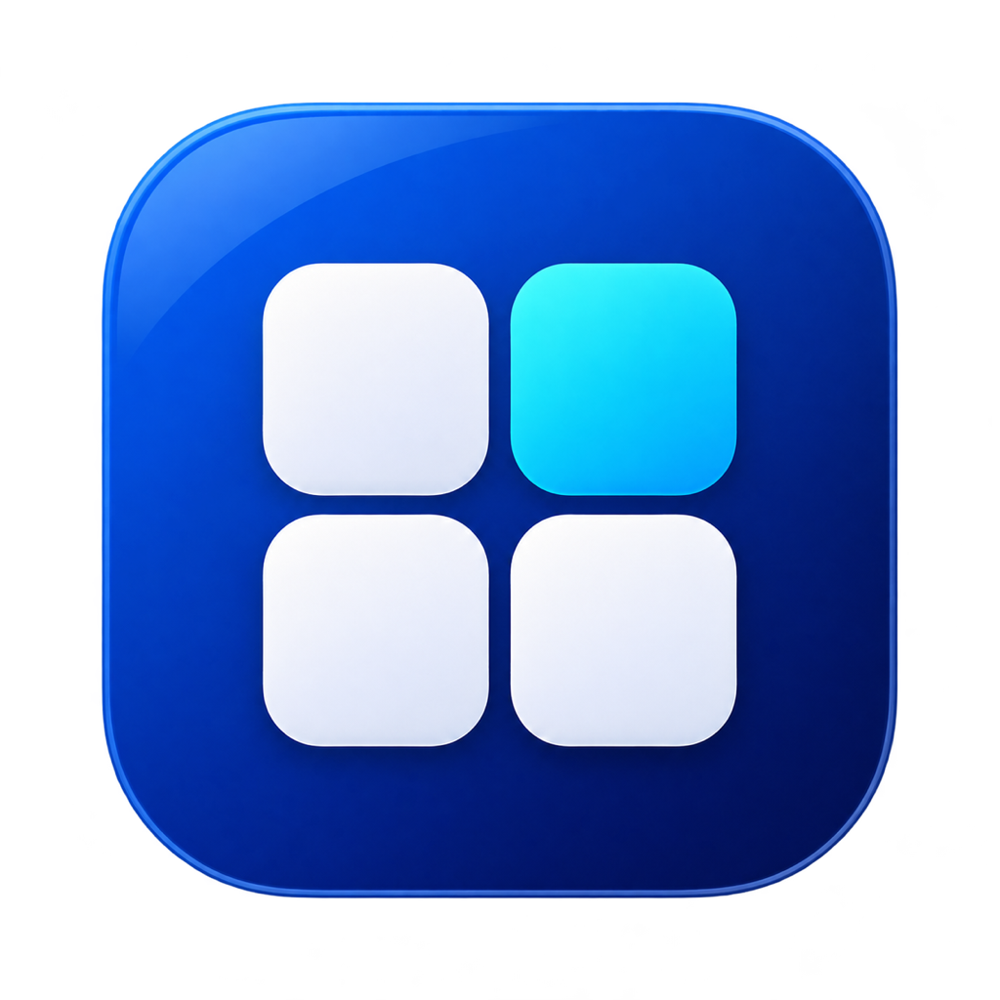

<p align="center">
  
</p>

# MakeTools

[简体中文](README.md) · **English**

MakeTools is a collection of macOS productivity tools built with Swift and AppKit. Check system status, stage files, and recover recently copied text from the top of your screen. In Finder, press Space to preview Markdown files.

**Requires macOS 14 or later.** You can build the app from source with Xcode Command Line Tools.

## Features

### Interface language

Choose **MakeTools → Language Settings…** (<kbd>⌘</kbd><kbd>,</kbd>) from the menu bar. You can follow the system language, choose a built-in language, or select an imported pack. Switching languages refreshes the main window and Dynamic Island while file reception continues. Newly opened upload pages use the selected language.

To create a language pack, click **Export Translation Template…**. Open the resulting UTF-8 JSON file in a text editor, update `locale`, `displayName`, and the translations, then choose **Import Language Pack…**. Include as many translated entries as you like. Missing text falls back to the built-in translation for the same language, then English, then Simplified Chinese.

- Keep `formatVersion` at `1`. Use a BCP 47 language tag such as `fr-FR`.
- Keep the keys in `messages` unchanged. Preserve placeholders such as `{filename}` and `{count}`, and reorder them as needed.
- Use the optional `plurals` dictionary for count-based messages. Keep the base message in `messages` and include an `other` form for each entry in `plurals`. MakeTools selects the form according to the language's plural rules.
- Finder Quick Look and macOS permission prompts use the built-in language selected by the system.

### Dynamic Island

Dynamic Island sits at the top center of the screen. It offers automatic, notch-aligned, and floating pill shapes. The floating pill sits below the menu bar and camera area. Choose Midnight Blue, Frosted Glass, Graphite, or Warm Amber under **Dynamic Island → Appearance and Interaction → Material**. Materials work with any shape. Frosted Glass follows the macOS Reduce Transparency setting.

Click the pill to expand it. If hover to expand is enabled, only hovering over the pill opens the panel. You can customize the collapsed width, title, and live metrics. If you select multiple metrics, the collapsed bar cycles through them every three seconds.

Click the pencil in the expanded panel or open **Appearance and Interaction → Expanded Panel Layout**. Drag to reorder cards in the preview, or drag between the preview and the library to add or remove cards. Click **Done** to apply changes or **Cancel** to keep the original layout.

| Feature | How to use it |
| --- | --- |
| System status | View CPU, memory, and battery status. Enable upload and download speeds independently and add either one to the collapsed bar. |
| Volume and battery alerts | Adjust or mute audio. See alerts when power is connected or disconnected or the battery runs low. |
| Focus timer | Choose 5, 15, or 25 minutes. Start, pause, or reset the timer from Dynamic Island. |
| File shelf | Drop up to nine files anywhere on the visible island. When the panel is collapsed, staged files appear in a draggable row under the pill. Expand the shelf to open files or share them via macOS. |
| Keep awake | Keep the Mac awake during a presentation or whenever you need the screen to stay on. |
| Clipboard history | Click the clipboard menu to see the eight most recent text entries. Select one to copy it again in its original format. |
| Calendar and date countdowns | Select a date to see how many days remain or have passed. Save events using Gregorian or lunar dates. The calendar marks public holidays for the selected country or region, and its card shows upcoming events and holidays. You can also [sync system events and reminders](#sync-calendar-and-reminders). |
| Local network transfer | Turn on file reception from Dynamic Island, show a QR code, or copy the upload link. See [Local network transfer](#local-network-transfer). |
| Web bookmarks | Open the bookmarks panel from Dynamic Island and enter a URL to save it. Click a bookmark to open it in your default browser or use its trash button to delete it. |

When MakeTools is active, press <kbd>⌘</kbd> <kbd>⇧</kbd> <kbd>D</kbd> to expand or collapse Dynamic Island. Closing the main window keeps the app running in the menu bar, where you can reopen the window or quit.

### Holiday region

Open the **Holidays** tab to choose a region. By default, MakeTools follows your macOS Language & Region setting. You can also choose a country or region manually. The first day of the week follows the selected region. Mainland China includes official days off and makeup workdays. Other supported regions show nationwide public holidays.

Holiday requests send the region code and year to [holiday-cn](https://github.com/NateScarlet/holiday-cn) for mainland China or [Nager.Date](https://date.nager.at/Api) for other regions. For state, provincial, or local holidays, add a calendar subscription in macOS Calendar and use the system calendar view described below.

### Sync Calendar and Reminders

1. Expand Dynamic Island, open the calendar card, and select the system calendar tab.
2. Grant access to Calendar and Reminders when prompted. Each permission can be enabled independently. If you previously denied access, use the button in the app to open **System Settings → Privacy & Security** and change the permission.
3. Select a date to see that day's events and incomplete reminders. Blue dots indicate events, and orange dots indicate reminders. Reminders without a due date appear separately.

MakeTools refreshes automatically when events or reminders change. The synced view is read-only. Use the macOS Calendar or Reminders app to edit an event or complete a reminder.

### Local network transfer

1. Open **Local Network Transfer** in the main window and choose a port and destination folder. The defaults are port `8765` and the **Downloads** folder. Stop receiving before changing these settings.
2. Turn on file reception in the main window or click **Enable** on the transfer card in Dynamic Island. Connect the sending device and Mac to the same local network, then scan the QR code or open the copied link and select files to upload.
3. Open the destination folder on your Mac to find the files. If a file with the same name already exists, MakeTools adds a number to the new filename. The limit is 5 GiB per file. Turning off reception cancels incomplete uploads and invalidates the current link.

You can also upload from the command line. Replace the placeholder with the complete link, including the trailing `/`.

```sh
curl --fail-with-body --upload-file "./file.pdf" "<current upload link>"
```

Transfers use HTTP over the local network. Share the upload link on trusted networks. If the page does not open, check that both devices are on the same local network and that the Mac firewall allows incoming connections for MakeTools.

### Password book

Expand Dynamic Island and click the key icon. Enter a website, account, and password. Once saved, you can select an entry from the menu, update it, copy its account or password separately, or confirm deletion.

Passwords are stored locally in the macOS Keychain. MakeTools excludes passwords copied through its **Copy Password** action from its clipboard history. While the app is running, it clears a copied password after 45 seconds if the clipboard has not changed. Regular clipboard history is kept in memory for the current app session.

### Markdown preview and Quick Look

- In the app's Markdown preview tool, open a file or try the built-in demo.
- After starting MakeTools, select a Markdown file such as `.md` or `.markdown` in Finder and press Space to preview it.
- The renderer supports tables, task lists, nested lists, syntax highlighting, GitHub alerts, and YAML front matter. You can copy the original Markdown, plain text, or individual code blocks.

Both views share the Swift Markdown parser. The in-app preview uses WebKit, and the Quick Look extension uses native AppKit views. Try it with the [sample Markdown file](Samples/demo.md).

## Download

Download a DMG from [GitHub Releases](https://github.com/anxiaoying369-bot/MakeTools/releases). Choose `arm64` for Apple silicon or `x86_64` for Intel. Open the DMG and drag `MakeTools.app` into **Applications**. The app sets up Finder Quick Look for Markdown automatically on launch. If setup fails, the app shows how to enable it manually. Release builds use ad hoc signing and are distributed without Apple notarization.

## Run from source

Download or clone the repository and run the following command from its root. If you need Xcode Command Line Tools, run `xcode-select --install` first.

```sh
make run
```

`make run` builds and opens `build/MakeTools.app`. To build the app without opening it, run `make build`. The build script compiles for the current Mac's architecture and signs the app and extension ad hoc.

### Use the Quick Look extension

Start MakeTools, select `Samples/demo.md` in Finder, and press Space. You can also run `make preview-demo`.

To install the app and extension from the command line, quit any running instance of MakeTools and run the following from the repository root.

```sh
make install
open /Applications/MakeTools.app
```

The install script replaces `/Applications/MakeTools.app`, registers the included extension, and refreshes the Quick Look cache. It also removes the old standalone `/Applications/MarkdownQuickLook.app`.

If Finder still shows its default preview, open the system extension settings from the app's extension overview. You can check the extension registration with this command.

```sh
pluginkit -m -v -p com.apple.quicklook.preview | grep -i MakeTools
```

## Package

Run `make package` or `make dmg` from the repository root to create the installer for the current architecture at `build/MakeTools-v<version>-macos-<architecture>.dmg`. The DMG shows a drag-to-Applications layout and contains the app with its Quick Look extension.

The [packaging workflow](.github/workflows/package.yml) tests and packages the app on Apple silicon and Intel macOS runners. Pushing a `v*` tag that matches the app version publishes both DMGs and a SHA-256 checksum file to GitHub Releases.

## Develop and contribute

```sh
make test
```

Tests cover Markdown rendering, Quick Look setup helpers, Dynamic Island layout and file dragging, system metrics, multi-day calendar events and reminder time zones, regional holidays, local network uploads and cleanup, and language pack fallback and plural rules.

To work in Xcode, generate the project from [project.yml](project.yml) with [XcodeGen](https://github.com/yonaskolb/XcodeGen).

```sh
xcodegen generate
open MakeTools.xcodeproj
```

| Path | Contents |
| --- | --- |
| [Sources/App](Sources/App) | App entry point, main window, and menu bar behavior. |
| [Sources/Core](Sources/Core) | Tool registration, clipboard utilities, and shared UI components. |
| [Sources/Tools](Sources/Tools) | Dynamic Island, calendar, local network transfer, password book, Markdown preview, and extension overview. |
| [Sources/Extensions/MarkdownQuickLook](Sources/Extensions/MarkdownQuickLook) | Finder Quick Look extension. |
| [Resources/Languages](Resources/Languages) | Built-in language packs and translation references. |
| [Tests](Tests) | Markdown, Dynamic Island, calendar, installation, local network transfer, and localization tests. |
| [Assets](Assets) | App icon source artwork and the packaged ICNS file. |

To add a sidebar tool, implement [ToolModule](Sources/Core/ToolModule.swift) and register it in `ToolRegistry.defaultTools()`. When adding a Swift source file, update the compile list in the [command-line build script](scripts/build.sh).

Issues and pull requests are welcome. When reporting a problem, include your macOS version, chip type, and steps to reproduce it. For Dynamic Island layout issues, also mention whether the screen has a notch and which style you selected.

## License

This project is available under the [MIT License](LICENSE).
