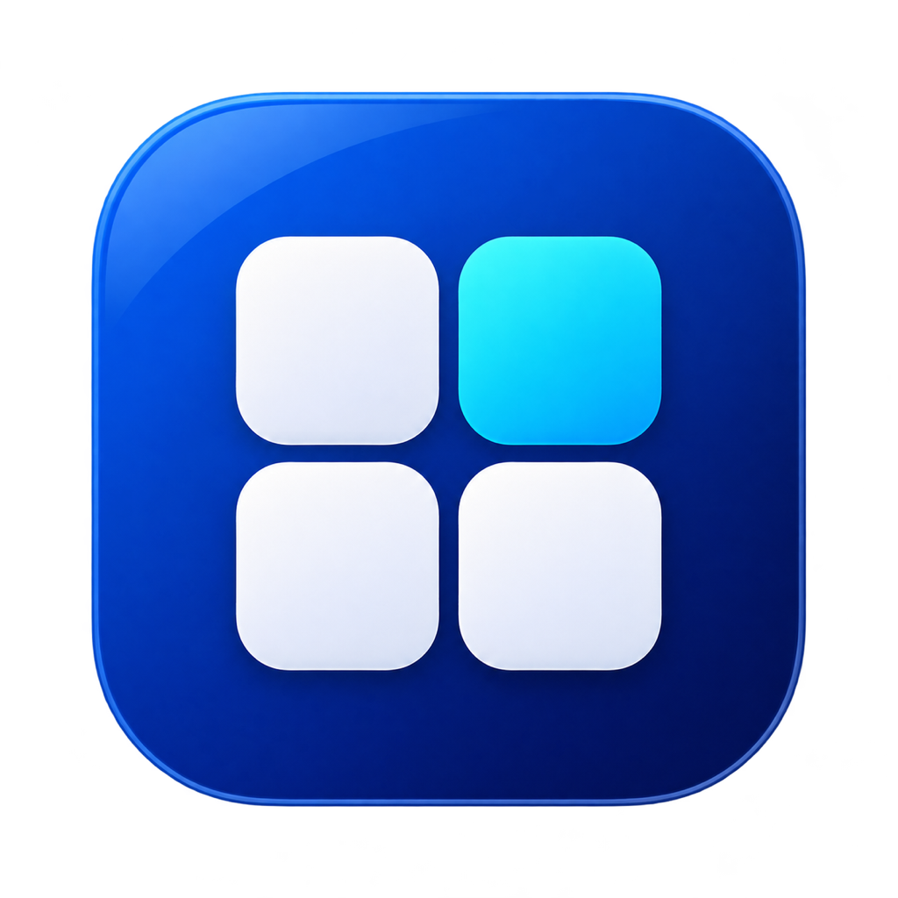

<p align="center">
  
</p>

# MakeTools

MakeTools 是一个用 Swift 和 AppKit 编写的 macOS 效率工具集。你可以在屏幕顶部查看系统状态、暂存文件、找回剪贴板内容，也可以在访达里按空格预览 Markdown。

需要 **macOS 14 或更高版本**。项目支持使用 Xcode Command Line Tools 从源码构建。

## 功能

### 灵动岛

灵动岛位于屏幕顶部中央，提供自动适配、贴顶刘海和悬浮胶囊三种样式。点击灵动岛即可展开，也可以在主窗口的「系统灵动岛」页面启用悬停展开，或自定义收起时的宽度、文字和实时指标。多选的实时指标每 3 秒轮播一项。展开后长按卡片空白处或点击铅笔进入编辑，可拖动卡片排序、移除或重新添加。

| 功能 | 使用方式 |
| --- | --- |
| 系统状态 | 查看 CPU、内存及电池状态。上行和下行网速可独立开启，并分别加入收起栏轮播。 |
| 音量与电池提示 | 调节音量或静音，在电源接入、断开或电量偏低时查看提示。 |
| 专注倒计时 | 选择 5、15 或 25 分钟，用灵动岛开始、暂停或重置计时。 |
| 文件暂存架 | 拖入文件，最多暂存 9 项。展开后可打开、拖出，或通过系统分享菜单发送。 |
| 防休眠 | 在演示或需要保持屏幕亮起时开启。 |
| 剪贴板历史 | 点击「剪贴板 ▾」查看最近 8 条文本记录，点选即可按原格式重新复制。 |
| 日历与日期倒计时 | 在月历里选一天，查看还有多少天或已过去多少天。可保存多个公历或农历事件。月历会标记中国大陆放假和调休补班，日历卡片会显示最近的事件和假期倒计时。也可[同步系统日程和待办](#同步系统日历和提醒事项)。 |
| 网络书签 | 从灵动岛打开书签面板，输入网址即可收藏。点击书签卡片可用默认浏览器打开，点击右侧垃圾桶可删除。 |

MakeTools 在前台时，可以按 <kbd>⌘</kbd> <kbd>⇧</kbd> <kbd>D</kbd> 展开或收起灵动岛。关闭主窗口后，应用会留在菜单栏，可从菜单栏重新打开窗口或退出。

### 同步系统日历和提醒事项

1. 展开灵动岛，打开日历卡片并切换到「系统日历」。
2. 分别点击「允许访问日历」和「允许访问提醒事项」，按 macOS 提示授权。两项权限可独立开启；如先前拒绝，可通过应用中的按钮前往「系统设置 → 隐私与安全性」修改权限。
3. 在月历中选中日期，查看当天的日程和未完成待办。蓝点代表有日程，橙点代表有待办。没有日期的待办会单独列出。

系统日程和待办发生变化后，列表会自动刷新。系统数据在 MakeTools 中以只读方式显示，编辑日程或完成待办请在 macOS「日历」或「提醒事项」中操作。

### 密码本

展开灵动岛，点击钥匙图标，填写网站名称、账户和密码。保存后，从下拉菜单选择记录，即可更新资料，分别复制账户和密码，或确认后删除该记录。

密码保存在本机 macOS 钥匙串中。通过「复制密码」放入系统剪贴板的内容会被 MakeTools 的剪贴板历史跳过。应用运行期间，如果剪贴板内容未变化，复制的密码会在 45 秒后清除。普通剪贴板历史只保存在当前运行的进程中。

### Markdown 预览与 Quick Look

- 在应用的「Markdown 预览」页面打开文件，或直接查看内置演示。
- 启动 MakeTools 后，在访达中选中 `.md`、`.markdown` 等 Markdown 文件并按空格预览。
- 支持表格、任务清单、嵌套列表、代码高亮、GitHub 提示块和 YAML Front Matter。可以复制 Markdown 原文、纯文本或单个代码块。

两个入口共用 Swift Markdown 解析器。应用内预览通过 WebKit 显示，Quick Look 扩展使用 AppKit 原生视图。可以用 [示例 Markdown](Samples/demo.md) 体验。

## 下载

从 [GitHub Releases](https://github.com/anxiaoying369-bot/MakeTools/releases) 下载 DMG 安装包。Apple 芯片选 `arm64`，Intel 芯片选 `x86_64`。打开 DMG 后按安装界面指引将 `MakeTools.app` 拖入「应用程序」文件夹即可。打开 MakeTools 时会自动设置访达的 Markdown 快速预览，设置失败时会在应用内提示如何手动启用。发布包使用 Ad-hoc 签名，未经 Apple 公证。

## 从源码运行

下载或克隆源码后，在项目根目录运行以下命令。若尚未安装 Xcode Command Line Tools，可以先执行 `xcode-select --install`。

```sh
make run
```

`make run` 会构建并打开 `build/MakeTools.app`。只需要应用包时，运行 `make build`。构建脚本按本机架构编译，并对应用及扩展执行 Ad-hoc 签名。

### 使用 Quick Look 扩展

启动 MakeTools 后，在访达中选中 `Samples/demo.md` 并按空格。也可以运行 `make preview-demo`。

如果希望用命令行安装应用及扩展，关闭正在运行的 MakeTools 后，在项目根目录执行以下命令。

```sh
make install
open /Applications/MakeTools.app
```

安装脚本会替换 `/Applications/MakeTools.app`、注册内置扩展并刷新 Quick Look 缓存。它也会清理旧版独立应用 `/Applications/MarkdownQuickLook.app`。

如果仍显示系统默认预览，可从主窗口的「系统扩展」页打开系统扩展设置，并用下面的命令确认 MakeTools 扩展的注册状态。

```sh
pluginkit -m -v -p com.apple.quicklook.preview | grep -i MakeTools
```

## 打包

在项目根目录运行 `make package`（或 `make dmg`），可生成当前架构的图形化安装包 `build/MakeTools-v<版本>-macos-<架构>.dmg`。DMG 打开后提供「将 MakeTools 拖入应用程序」的图形安装界面，应用内含 Quick Look 扩展。

[打包工作流](.github/workflows/package.yml) 在 Apple 芯片和 Intel 的 macOS runner 上分别测试和打包。推送与应用版本一致的 `v*` 标签后，工作流会把两个架构的 DMG 和 SHA-256 校验文件上传到 GitHub Release。

## 开发与贡献

```sh
make test
```

测试覆盖 Markdown 渲染、Quick Look 安装辅助逻辑、灵动岛布局、拖放、系统指标，以及日历的跨天日程与待办时区处理。

如果使用 Xcode，可以通过 [XcodeGen](https://github.com/yonaskolb/XcodeGen) 读取 [project.yml](project.yml) 并生成工程。

```sh
xcodegen generate
open MakeTools.xcodeproj
```

| 路径 | 内容 |
| --- | --- |
| [Sources/App](Sources/App) | 应用入口、主窗口和菜单栏行为。 |
| [Sources/Core](Sources/Core) | 工具注册、剪贴板和共用界面组件。 |
| [Sources/Tools](Sources/Tools) | 灵动岛、密码本、Markdown 预览、系统扩展概览。 |
| [Sources/Extensions/MarkdownQuickLook](Sources/Extensions/MarkdownQuickLook) | 访达 Quick Look 扩展。 |
| [Tests](Tests) | Markdown、灵动岛、日历和安装辅助逻辑的测试。 |
| [Assets](Assets) | 应用图标源图和打包所用的 ICNS。 |

添加侧栏工具时，实现 [ToolModule](Sources/Core/ToolModule.swift)，并在 `ToolRegistry.defaultTools()` 中注册。新增 Swift 源文件时，请一并更新 [命令行构建脚本](scripts/build.sh) 中的编译清单。

欢迎提交 Issue 或 Pull Request。报告问题时，请附上 macOS 版本、芯片类型和复现步骤。涉及灵动岛布局时，也请说明屏幕是否有刘海以及所选样式。

## 许可证

本项目采用 [MIT 许可证](LICENSE)。
